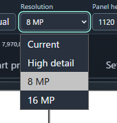
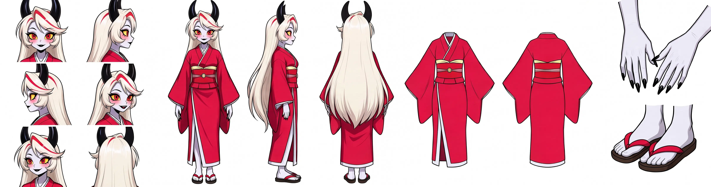

# H3 Character Sheet Designer


[日本語](#日本語) · **Package v1.4.5**

Create character reference sheets with native MiniMax H3 image-reference conditioning. One character image and up to three optional part references are passed through unchanged. Select up to 13 views: six head views, three full-body views, front/back clothing, paired hands and paired feet/footwear.

## What's New — v1.4.5

In MiniMax H3 Image, the 11-view **No clothing · natural body surface** layout assigns each portrait to a specific slot when **Use Layout Image** is on and the full-body side prompt is edited. The prompt requests white gaps between views and keeps the shared reference stance instruction scoped to unedited full-body views. The clothing menu tooltip explains how the mode treats clothing panels, hands, and footwear.

On ComfyUI_W, a GPU run with the same wolf reference, seed 42, and a 4224 × 1280 canvas used **Use Layout Image** on and an edited standing side-view prompt. The finished sheet had no visible guide lines, all three full-body views showed the wolf standing on two legs, and all 11 requested views appeared exactly once. Results can vary with the reference and seed. [Issue #6](https://github.com/ukr8b3g-cmyk/H3-Character-Sheet-Designer/issues/6) · [Release notes](docs/releases/v1.4.5.md)

## What's New — v1.4.4

**No clothing · natural body surface** is now available under **Clothing shape** in MiniMax H3 Image and P-H3 v1.3. Choose it for unclothed animal characters or mascots to keep the body structure, fur, colors, and markings from the reference. Hand and footwear settings still apply independently.

- **All · 13 views** generates 11 views in this mode. The clothing front and back selections are kept in the workflow and restored when you switch **Clothing shape** back to **Auto**. Choose at least one non-clothing view. If a connected reference has a clothing role, disconnect it or change its role before generating.
- With **Use Layout Image** on, the guide uses plain panel frames. With it off, the MiniMax H3 Image prompt keeps the reference stance in the full-body side view, and the P-H3 prompt reserves the right column for separate hand and foot close-ups.

Both workflows produced 11 views, including a bipedal full-body side view and separate hand and foot close-ups, in a GPU test with the same wolf reference, seed 42, and 4224 × 1280 output. View count and pose can vary with the reference and seed. [Issue #6](https://github.com/ukr8b3g-cmyk/H3-Character-Sheet-Designer/issues/6) · [Release notes](docs/releases/v1.4.4.md)

## What's New — v1.4.3

For MiniMax H3 Image, **Standard · 5 views** in Auto size with **Use Layout Image** enabled gives each full-body panel about 6% more width and leaves 10.5% above and at least 3.5% below the figure in the guide. The two portrait panels give up a little width to keep the sheet dimensions fixed.

Fixed-seed GPU comparisons at 3168 × 1280 produced all five views for both reference images. The horned character fit from horn tips to shoe soles in all three full-body views. Framing can vary with the reference, seed, and output size. [Release notes](docs/releases/v1.4.3.md)

## What's New — v1.4.2

- **Dropdowns retain selections.** Saving and undo snapshots no longer reset a selection before it is committed. Tested in Chrome by selecting **8 MP** and **Basic · 4 views** with the mouse, then saving and reopening the workflow JSON.
- **External seed wiring.** The included P-H3 and MiniMax H3 Image templates carry the seed wiring fixes from the previous update to main. Existing node IDs and titles are preserved.

## What's New — v1.4.1

- **Bare hands and no shoes.** These explicit settings replace the conflicting reference-preservation text in the default hand and footwear views. The no-shoes prompt retains reference socks or tights. Auto and custom view text keep their existing behavior.
- **Hands and footwear with Layout Image OFF.** Selecting just these two views requests one hands close-up above one feet close-up, separated by white space.
- **Part reference priority.** Explicit settings take priority, followed by compatible Part prompts and dedicated references. If references of the same role conflict, the prompt favors the later input.

A fixed-reference, fixed-seed GPU comparison produced one view of bare hands and one view of feet in black socks, with a white gap. Composition and fine details can vary. The existing workflow files and node names are unchanged, including the P-H3 workflow. Restart ComfyUI after updating.

## What's New — v1.4.0

**Requires H3 Character Sheet Designer v1.4.0+ and ComfyUI 0.45.0+ for the new MiniMax H3 Image workflow.** Update ComfyUI if `MiniMax H3 Image Conditioning` is missing, then restart and reload the browser after updating the Designer.

| Workflow | Designer node | Model path |
| --- | --- | --- |
| [MiniMax H3 Image Character Sheet Designer](workflows/MiniMax%20H3%20Image%20Character%20Sheet%20Designer.json) | **MiniMax H3 Image Character Sheet Designer v1.4.0** | MiniMax H3 Image Conditioning and three image-model files |
| [H3 Character Sheet Designer — P-H3 Subgraph](workflows/H3%20Character%20Sheet%20Designer%20-%20P-H3%20Subgraph.json) | **H3 Character Sheet Designer v1.3.0** | P-H3 Image Conditioning and its original model set |

- **New defaults:** Standard · 5 views, Auto / **High detail**, Layout Image OFF. The four Auto choices are Current, High detail, 8 MP and 16 MP. Manual uses the dimensions you enter.
- **Image-specific prompts:** short layout instructions replace numeric panel coordinates. Single view requests one centered depiction. All 13 with Layout Image OFF describes six portraits on the left, three full-body views in the center, front/back outfit next, and hands above footwear on the far right.
- **Sampling and output:** Euler / Simple, 6 steps, CFG 1, denoise 1. The template uses ComfyUI's built-in Save Animated WEBP at 1 FPS and generates a single static image.
- **Existing workflows:** the P-H3 node keeps its v1.3.0 name, sockets and behavior. v1.2.2 remains available to saved workflows as a deprecated node. The release offers the two templates above as direct downloads.

### MiniMax H3 Image model downloads

Use the exact three files selected in the template. Set CLIP type to `minimax`. Select your character image in Load Image before running. The workflow uses the supplied image as a generation reference.

| Component | Download | Folder under `ComfyUI/models/` |
| --- | --- | --- |
| Diffusion model | [minimax_h3_image_pruned_int8_convrot.safetensors](https://huggingface.co/Comfy-Org/MiniMax-H3-Image/resolve/main/diffusion_models/minimax_h3_image_pruned_int8_convrot.safetensors) | `diffusion_models/minimax/` |
| Text encoder | [qwen3vl_32b_minimax_h3_nvfp4_awq.safetensors](https://huggingface.co/Comfy-Org/MiniMax-H3-Image/resolve/main/text_encoders/qwen3vl_32b_minimax_h3_nvfp4_awq.safetensors) | `text_encoders/` |
| VAE | [minimax_h3_image_vae_fp16.safetensors](https://huggingface.co/Comfy-Org/MiniMax-H3-Image/resolve/main/vae/minimax_h3_image_vae_fp16.safetensors) | `vae/` |

[ComfyUI's MiniMax H3 Image guide](https://docs.comfy.org/tutorials/image/minimax/minimax-h3-image)

### P-H3 compatibility template model downloads

| Component | Download | Folder under `ComfyUI/models/` |
| --- | --- | --- |
| Diffusion model | [minimax_h3_fl2va_pruned_int8_convrot.safetensors](https://huggingface.co/Comfy-Org/MiniMax-H3/resolve/main/diffusion_models/minimax_h3_fl2va_pruned_int8_convrot.safetensors) | `diffusion_models/minimax/` |
| Text encoder | [p-h3-image_text_encoder_int8_convrot.safetensors](https://huggingface.co/PrunaAI/P-H3-Image-Comfy/resolve/main/text_encoders/p-h3-image_text_encoder_int8_convrot.safetensors) | `text_encoders/` |
| VAE | [p-h3-image_vae_int8_convrot.safetensors](https://huggingface.co/PrunaAI/P-H3-Image-Comfy/resolve/main/vae/p-h3-image_vae_int8_convrot.safetensors) | `vae/` |
| LoRA | [p-h3-image_lora_bf16.safetensors](https://huggingface.co/PrunaAI/P-H3-Image-Comfy/resolve/main/loras/p-h3-image_lora_bf16.safetensors) | `loras/P-H3-Image/` |





*13-view GPU example, 4832 × 1280, Layout Image OFF. The requested views appeared once each in this run. Fine details and viewpoint adherence can vary with reference, seed and resolution. 8 MP and 16 MP can require more VRAM and time.*

## Previous update — v1.3.1: editable view prompts

Package v1.3.1 keeps the existing **H3 Character Sheet Designer v1.3.0** and **v1.2.2** node names. In the v1.3.0 node, open **Prompts** after Settings, select one of 13 views and edit its H3 base instruction. **Apply** saves it; **Reset this prompt** restores that view's default. Blank overrides are allowed. Valid pending edits are committed on workflow save/queue. Each override accepts up to 2,000 UTF-16 units.

These are H3 instructions, not Anima tags. Layout, image references, Part prompts and settings are added separately. This edits a view's base instruction rather than the whole final prompt. Overrides persist in saved workflows. Unedited workflows retain their original instructions. Existing workflow files, node IDs/titles, sockets, image passthrough and Layout Image ON/OFF are unchanged. The previous v1.2.2 node does not gain this editor.

Validation: local implementation passed Python 176 and JavaScript/DOM 112 tests. Live Chrome/ComfyUI_W checks covered Apply, Reset, save/reload and Layout Image ON/OFF; live preview API checks covered reference numbering. This update adds no GPU quality, speed or VRAM benchmark. Human remnants in clothing panels and missing/duplicate views remain possible; custom edits may weaken viewpoint compliance. Restart ComfyUI and reload the browser after updating.

## What's New — v1.3

- **New:** two versioned nodes: **H3 Character Sheet Designer v1.3.0** and the previous **v1.2.2**. Use v1.3.0 for this release's changes.
- **New:** MOSS-style preset order, including **7 views · hands and feet**. Seven-view layout has two portraits stacked on the left, three bodies in the center, and hands above feet at the far right.
- **Updated:** one common guide/layout for ON and OFF. Both display the same arrangement and dimensions. **Use Layout Image** controls whether the guide is passed to H3; OFF still outputs `None` for the guide image.
- **Updated:** smaller guide margins/gaps and wider Auto full-body columns so the figure can reach the requested panel height without changing its proportions. Auto output width/pixel count can grow, increasing time and VRAM use. Manual keeps the specified canvas size.
- **Updated:** compact controls and Settings tab; remove the Worn/Garments-only UI switch. Clothing shape retains Auto / Pants / Skirt or robe. V1.3 normalizes saved Worn values to garment extraction.
- **Small prompt adjustments:** clothing uses extraction, `No human`, and flat-outfit instructions scoped to clothing panels. Clothing-only output retains outfit features rather than person identity. **Clothing and all-13 results have not demonstrated a major general improvement.** Human remnants, missing/duplicate views and outfit/full-body confusion remain possible.
- **New template:** supplied v1.3 subgraph workflow with four character/part images and eight Designer outputs. Uses Hybrid V4, H3 INT8 TE and Pika Ref2VA; existing node titles are preserved.

See [release notes](docs/releases/v1.3.0.md) and [CHANGELOG](CHANGELOG.md). Previous changes remain recorded there.

## Older v1.3 workflows

P-H3 template and archived releases: [P-H3 subgraph](workflows/H3%20Character%20Sheet%20Designer%20-%20P-H3%20Subgraph.json) · [v1.3](https://github.com/ukr8b3g-cmyk/H3-Character-Sheet-Designer/releases/tag/v1.3.0) · [v1.2.2](https://github.com/ukr8b3g-cmyk/H3-Character-Sheet-Designer/releases/tag/v1.2.2). The P-H3 workflow uses `minimax_h3_fl2va_pruned_int8_convrot.safetensors` with the P-H3 image text encoder and VAE.

1. Update/install this node pack, restart ComfyUI, and reload the browser (Ctrl+F5).
2. Open **[H3_Character_Sheet_Designer_v1.3.json](https://github.com/ukr8b3g-cmyk/H3-Character-Sheet-Designer/releases/tag/v1.3.0)**. [Release download](https://github.com/ukr8b3g-cmyk/H3-Character-Sheet-Designer/releases/download/v1.3.0/H3_Character_Sheet_Designer_v1.3.json).
3. Select installed models and valid images in every connected Load Image node. Disconnect unused optional inputs on the Designer. Models/images are not bundled.
4. Choose views and optional part instructions/reference roles. Auto retains unspecified reference appearance. Fix the seed for comparisons.
5. Start with **Use Layout Image OFF**, enabling it when composition guidance helps. ON can transfer guide proportions or leave guide content. MiniMax H3 Image adjusts the guide framing for **Standard · 5 views** in Auto size when enabled.

The template requires native ComfyUI H3/subgraph support and **[rgthree-comfy](https://github.com/rgthree/rgthree-comfy)** for Power LoRA Loader. The Designer adds no Python runtime dependency. Pika Ref2VA is enabled at 1.0, FL2VA is disabled, and ManualSigmas has eight intervals. These are the supplied comparison settings, not a universal optimum or the original Pika six-NFE sampling contract. Keep the supplied save format unless you intentionally change it.


## Model downloads for the older Pika v1.3 template

Set the CLIP loader type to **`minimax`** and select an **H3** encoder. Music3 encoders are incompatible and cause sampler matrix-shape errors (for example 32768 versus 5120). Model switching/first loading is separate from layout compilation.

| Component | Download / filename | Folder under models/ |
| --- | --- | --- |
| Diffusion / template | [DaSiWa Hybrid V4 INT8](https://civitai.red/models/2877206/dasiwa-minimax-h3?modelVersionId=3391862) — `DasiwaMinimaxH3_dasiwaHybridV4_int8.safetensors` | `diffusion_models/minimax/` |
| Native alternative | [H3 Ref2VA INT8](https://huggingface.co/Comfy-Org/MiniMax-H3/resolve/main/diffusion_models/minimax_h3_ref2va_pruned_int8_convrot.safetensors) — `minimax_h3_ref2va_pruned_int8_convrot.safetensors` | `diffusion_models/` |
| Text encoder / CLIP | [H3 Qwen3-VL INT8](https://huggingface.co/Comfy-Org/MiniMax-H3/resolve/main/text_encoders/qwen3vl_32b_minimax_h3_int8_convrot.safetensors) — `qwen3vl_32b_minimax_h3_int8_convrot.safetensors` | `text_encoders/` |
| Alternative encoder | [H3 NVFP4 AWQ](https://huggingface.co/Comfy-Org/MiniMax-H3/resolve/main/text_encoders/qwen3vl_32b_minimax_h3_nvfp4_awq.safetensors) — `qwen3vl_32b_minimax_h3_nvfp4_awq.safetensors` | `text_encoders/` |
| Video VAE | [H3 VAE INT8](https://huggingface.co/Comfy-Org/MiniMax-H3/resolve/main/vae/minimax_h3_video_vae_int8_convrot.safetensors) — `minimax_h3_video_vae_int8_convrot.safetensors` | `vae/` |
| Alternative VAE | [H3 VAE FP16](https://huggingface.co/Comfy-Org/MiniMax-H3/resolve/main/vae/minimax_h3_video_vae_fp16.safetensors) — `minimax_h3_video_vae_fp16.safetensors` | `vae/` |
| Pika LoRA / enabled | [Ref2VA](https://huggingface.co/Comfy-Org/MiniMax-H3/resolve/main/loras/pika_h3_flex_ref2va_v1_bf16.safetensors) — `pika_h3_flex_ref2va_v1_bf16.safetensors` | `loras/minimax/` |
| Pika LoRA / disabled | [FL2VA](https://huggingface.co/Comfy-Org/MiniMax-H3/resolve/main/loras/pika_h3_flex_fl2va_v1_bf16.safetensors) — `pika_h3_flex_fl2va_v1_bf16.safetensors` | `loras/minimax/` |

Choose the adapter matching your base model and conditioning path. Both Pika links are provided; this template enables Ref2VA only. Follow model licenses/access requirements. The `minimax/` subfolder is template organization, not a required ComfyUI convention.

## Older Pika v1.3 wiring and reference roles

| Designer output | Native H3 input |
| --- | --- |
| `prompt`, `width`, `height` | matching prompt/dimension inputs |
| `character_image` | `ref_images.ref_image_0` |
| `layout_image` | `ref_images.ref_image_1` |
| `reference_image_1` / `2` / `3` | `ref_images.ref_image_2` / `3` / `4` |

Keep the guide wire connected when OFF. Picture numbering skips None images. The four image pass-through outputs retain the input tensors unchanged. The template samples five frames and saves the first decoded frame as the static sheet.

In Part prompts assign extra references to Same character, Face, Head/face/hair, Complete outfit, Outfit front/back, Hands or Footwear. Explicit choices and part instructions take priority, then dedicated references, then the baseline image; later dedicated references of the same role take priority. These are text-based permissions, not regional attention isolation. Separate panel descriptions and `No human` do not guarantee that instructions stay inside one panel.

## Earlier node IDs and workflows

| Node ID / display version | Purpose |
| --- | --- |
| `H3CharacterSheetDesignerReferenceV13` / **v1.3.0** | Current workflow and common guide |
| `H3CharacterSheetDesignerReference13` / **v1.2.2** | Previous behavior for existing Reference13 workflows / comparison |

These are the previous node versions. Earlier Designer, Reference, Multi Reference and Reference V1.1 IDs are not registered in v1.3. Their historical source/workflow files and [old releases](https://github.com/ukr8b3g-cmyk/H3-Character-Sheet-Designer/releases/tag/v1.2.2) remain available; use an earlier release if those IDs are required. Saved workflows and user node titles are not automatically rewritten. V1.2.2 preserves its compiler/state behavior; its shared UI also has the Worn switch removed.

## Limits and validation

- Clothing/all-13 receive small targeted changes, not a demonstrated major visual-quality upgrade. Human remnants, missing/duplicate angles and outfit/body confusion remain possible across photo, anime, CG and seeds.
- Native image references do not guarantee exact identity, unseen surfaces, garment fidelity, viewpoints, view count or geometry. Guides can affect anatomy or be copied.
- Tighter margins and larger guide figures are geometric changes, not proof of GPU quality improvement. Increased Auto width can cost time/memory; Manual can remain width-limited.
- No additional LLM, TE text-generation step, hard BREAK separation or independently encoded regional conditioning was introduced.
- Packaged compiler/UI tests, guide parity, image pass-through and template wiring are checked separately from GPU quality. Earlier GPU comparisons included failures; final changes have no controlled multi-reference/seed success-rate, VRAM or speed benchmark. User functional confirmation is separate from that evaluation.

## Installation and updates

```sh
cd ComfyUI/custom_nodes
git clone https://github.com/ukr8b3g-cmyk/H3-Character-Sheet-Designer.git
```

Update existing installations through your usual Git/Manager workflow, restart ComfyUI, and reload the browser. Model weights are separate downloads. Check the [Comfy Registry listing](https://registry.comfy.org/nodes/h3-character-sheet-designer) for the version available through Manager.


## 日本語

### v1.4.5の変更点

MiniMax H3 Image版の **衣服なし／体表を保持** で、**Layout Image ON** かつ全身側面のプロンプトを編集した場合に、顔6面の位置を個別に指定し、ビュー間は白い余白で分けるよう指示します。参照と同じ姿勢を求める共通指示は、未編集の全身ビューにだけ適用します。衣装メニューのツールチップにも、このモードの衣装ビュー・手袋・履物の扱いを追記しました。

通常のComfyUI_Wで、同じオオカミ参照画像・seed 42・4224 × 1280・**Layout Image ON** を使用し、側面の編集文で二足の立ち姿を指定してGPU検証しました。ガイド線は出ず、正面・側面・背面の全身3面はすべて二足の立ち姿で、手足のアップを含む11面が各1枚揃いました。結果は参照画像やseedによって変わります。 [Issue #6](https://github.com/ukr8b3g-cmyk/H3-Character-Sheet-Designer/issues/6) · [リリースノート](docs/releases/v1.4.5.md)

### v1.4.4の変更点

MiniMax H3 Image版とP-H3 v1.3版の **衣装の型** に **衣服なし／体表を保持** を追加しました。服を着ていない動物やマスコットの体の構造、毛並み、色、模様を参照画像に合わせます。手袋と履物はそれぞれの設定で指定できます。

- **全13ビュー**を選ぶと、衣装の前後を除いた11面を生成します。13面の選択はワークフローに保存され、**Auto**に戻すと復元されます。衣装以外のビューを1面以上選んでください。衣装用の追加参照を接続している場合は、接続を外すか役割を変更してください。
- **Layout Image ON**では枠だけのガイドを使います。**OFF**では、MiniMax H3 Image版の全身側面に参照と同じ立ち方を指示し、P-H3版では右端の上段に手、下段に足のアップを割り当てます。

同じオオカミ参照画像・seed 42・4224 × 1280でGPU検証し、両版で全身側面が二足の姿勢を保ち、手足のアップを含む11面が揃いました。ビュー数や姿勢の追従は参照画像やseedにより変わります。 [Issue #6](https://github.com/ukr8b3g-cmyk/H3-Character-Sheet-Designer/issues/6) · [リリースノート](docs/releases/v1.4.4.md)

### v1.4.3の変更点

MiniMax H3 Image版で **Standard · 5 views**、Autoサイズ、**Use Layout Image ON** を選ぶと、ガイドの全身3枠を各約6%広げ、上に10.5%、下に3.5%以上の余白を取ります。顔アップ2枠から幅を振り分けるため、シートの出力寸法は変わりません。

3168 × 1280のGPU比較では、2枚の参照画像で5ビューが各1枚ずつ揃い、角のある人物も全身3面で角先から靴底まで収まりました。収まり方は参照画像、seed、出力サイズによって変わります。 [リリースノート](docs/releases/v1.4.3.md)

### v1.4.2の変更点

- **ドロップダウンの選択を保持。** 保存や履歴記録の際に、確定前の選択を上書きする再描画を削除しました。Chromeで **8 MP** と **Basic · 4 views** をマウスで選び、JSONの保存・再読込後も保持されることを確認しました。
- **外部seedの配線。** P-H3版とMiniMax H3 Image版の同梱テンプレートには、mainに反映済みのseed配線修正が入っています。既存のノードIDと表示名は従来どおりです。

### v1.4.1の変更点

- **素手・靴なし**を明示すると、手・履物ビューの既定文を切り替えます。靴なしでは参照の靴下・タイツを残すように指示します。Autoとユーザーが編集したビュー文は従来どおりです。
- **Layout Image OFFで手と履物だけを選択**すると、上段に手、下段に足のアップを各1面、白い余白で分けるように指示します。
- **追加参照の優先順位**は、明示設定、設定と両立するPart prompts、部位参照の順です。同じ役割の参照が競合した場合は、後の入力を優先するように指示します。

同じ参照画像・seedでのGPU比較では、素手と黒い靴下の足が白い余白を挟んで各1面出ました。配置や細部は生成条件により変わります。P-H3版を含む既存ワークフローとノード名は従来どおりです。更新後はComfyUIを再起動してください。

### v1.4.0の変更点

**新しいMiniMax H3 Image版には、この拡張のv1.4.0以上と、ComfyUI 0.45.0以上が必要です。** `MiniMax H3 Image Conditioning` が見つからない場合はComfyUIを更新してください。

- **新規** [MiniMax H3 Image用テンプレート](workflows/MiniMax%20H3%20Image%20Character%20Sheet%20Designer.json)。ノード表示は **MiniMax H3 Image Character Sheet Designer v1.4.0**。標準は **Standard · 5 views／Auto・High detail／Layout Image OFF**。Auto解像度はCurrent・High detail・8 MP・16 MP。Manualは入力した寸法を使用します。
- 座標を短い配置文に置き換えました。単体は中央に1枚。全13面のLayout Image OFFでは、頭部6面・全身3面・衣装前後・手と履物の順に配置します。掲載画像は4832 × 1280で13面が各1枚揃った例です。参照画像、seed、解像度によって見切れや向きのずれが起きる場合があります。
- **モデルは上の3ファイル**。CLIPは `minimax`。Load Imageで参照画像を選び、Euler / Simple、6ステップ、CFG 1で生成します。標準のSave Animated WEBPを1 FPSに設定し、静止画1枚を保存します。
- [従来のP-H3テンプレート](workflows/H3%20Character%20Sheet%20Designer%20-%20P-H3%20Subgraph.json)も同梱。ノード表示は **H3 Character Sheet Designer v1.3.0**。モデルは上のP-H3用の表を参照してください。v1.2.2は保存済みワークフローの互換用です。


### 更新 — v1.3.1：ビュー別プロンプト編集

パッケージは1.3.1ですが、ノード名 **H3 Character Sheet Designer v1.3.0／v1.2.2** は保持します。v1.3.0ノードのSettingsの次に **Prompts（プロンプト）** タブを追加。13ビューから選んでH3基本文を編集し、Applyで適用、Reset this promptで対象だけ初期化できます。空欄も保存可能。各欄2,000 UTF-16単位まで。有効な未適用編集は保存・キュー送信時にも確定します。

AnimaタグではなくH3用の文章です。配置・画像参照・部位プロンプト・設定は別途追加され、最終文全体の置換ではありません。編集はワークフロー内に保存し再読込で復元。未編集の旧ワークフローの生成指示、既存ファイル、ノードID・表示名・入出力・画像受け渡し・Layout Image ON/OFFは維持。旧v1.2.2には編集タブを追加しません。

ローカル実装でPython176件・JS/DOM112件成功。実Chrome／ComfyUI_Wで適用・初期化・保存／再読込・Layout Image ON/OFF、実APIで参照番号を確認しました。今回GPU画質・速度・VRAMの追加評価はしていません。衣装への人物混入やビュー欠落・重複の制約は残り、編集文によって方向の追従が弱まる場合もあります。更新後はComfyUI再起動とブラウザー再読込が必要です。


**パッケージv1.3.1（ノード名はv1.3.0／v1.2.2を維持）**。MiniMax H3本来の画像参照でキャラクターシートを生成します。人物画像1枚＋部位参照3枚をそのまま受け渡し、必要なら配置画像を追加参照にします。MOSS版の画像→文章化とは異なる方式です。

### v1.3の変更点 / What's New

- **New：** 今回版 **H3 Character Sheet Designer v1.3.0** と前版 **v1.2.2** の2ノードへ整理。今回の変更にはv1.3.0を使用します。
- **New：** MOSS版と同じプリセット順へ整理し、手・足付き7ビューを追加。頭部2面を左で上下、全身3面を中央、手を右上・足を右下へ配置します。
- **更新：** ON/OFFのガイドを1種類に統一。配置・寸法は同じで、Use Layout Imageは生成へガイド画像を渡すかだけを切り替えます。OFFの画像出力はNoneです。
- **更新：** ガイドの外周余白・枠間を縮小し、Autoの全身列を指定高まで描ける横幅へ拡張。縦横比を保持します。出力幅・画素数が増える場合があり、時間・VRAM負荷も増える可能性があります。Manualの指定サイズは保持します。
- **更新：** コンパクトな操作欄とSettingsタブ。Worn/Garments only切替を削除し、衣装型のAuto／Pants／Skirt or robeは維持。今回版の古いWorn保存値は衣服抽出として処理します。
- **小修正：** 衣装前後を抽出・No human・flatの短い文へ組み直し、衣装枠に適用。衣装単独の全体文も人物保持から衣服抽出へ整理しました。**衣装・全13面は汎用的な大幅改善を確認できていません。** 人物・身体の残留、向きの重複・欠落、衣装と全身の混同は残ります。
- **New：** 今回提示されたサブグラフ型ワークフローをテンプレートに採用。4画像入力・Designerの8出力と既存ノードtitleを保持。モデルは既定方針どおりHybrid V4／H3用INT8 TE／Pika Ref2VAへ整合しました。

[リリースノート](docs/releases/v1.3.0.md)・[変更履歴](CHANGELOG.md)も参照してください。

### 旧v1.3テンプレートの使い方

現行P-H3テンプレートと旧リリース — [P-H3サブグラフ版](workflows/H3%20Character%20Sheet%20Designer%20-%20P-H3%20Subgraph.json) · [v1.3版](https://github.com/ukr8b3g-cmyk/H3-Character-Sheet-Designer/releases/tag/v1.3.0) · [v1.2.2版](https://github.com/ukr8b3g-cmyk/H3-Character-Sheet-Designer/releases/tag/v1.2.2)。P-H3版は `minimax_h3_fl2va_pruned_int8_convrot.safetensors` とP-H3 Image用テキストエンコーダー・VAEを使用します。

1. 更新後にComfyUIを通常再起動し、ブラウザーをCtrl+F5で再読込。
2. [v1.3テンプレート](https://github.com/ukr8b3g-cmyk/H3-Character-Sheet-Designer/releases/tag/v1.3.0)を開き、導入済みモデルを選択。接続したLoad Imageすべてに有効な画像を指定するか、使わない追加参照入力をDesignerから外します。
3. ビュー・部位指示・参照の役割を設定。Autoは参照の外見を保つ選択です。比較時はseedを固定します。
4. Use Layout ImageはOFFから試し、配置の補助が必要ならONへ。ONではガイドの体形や図が残る場合があります。MiniMax H3 Image版の **Standard · 5 views** をAutoサイズで使う場合は、ONにすると全身ガイドの枠と余白を調整します。

配線は上の表と共通です。人物→ref_image_0、配置画像→1、追加参照3枚→2/3/4。NoneはPicture番号から除外。画像Tensorは変更せず返します。5フレームを生成し、最初の復号フレームを静止画として保存します。

テンプレートは[rgthree-comfy](https://github.com/rgthree/rgthree-comfy)が必要です。Pika Ref2VAは強度1.0で有効、FL2VAは無効、ManualSigmasは8区間。今回の比較設定であり万能な最適値やPika本来の6-NFE契約を保証するものではありません。保存形式は必要に応じて利用者が変更してください。

### モデルと参照の注意

モデル／TE／VAE／LoRAのファイル名・URLは上の **Model downloads for the older Pika v1.3 template** 表にまとめています。Pika Ref2VA／FL2VA両方のリンクを掲載し、このテンプレートはRef2VAだけを有効にしています。CLIPローダーはtype=minimax、H3用Qwen3-VLを使用。Music3用TEは非互換で行列サイズ不一致になります。初回ロードの時間とDesignerの配置計算は別の処理です。各モデルのライセンス・アクセス条件に従ってください。

追加参照の役割は同一人物／顔／頭部・髪／衣装全体／衣装前／衣装後／手／履物。明示設定・部位指示、専用参照、基準画像の順に適用し、同じ専用役割では後の接続を優先します。これはテキスト上の指示であり、領域attentionを完全分離する機能ではありません。

### 新旧ノードと残る制約

登録は今回版v1.3.0と前版v1.2.2の2つです。前版Reference13の生成動作・状態契約は保持しますが、共有UIのWorn切替は撤去しています。それより前のDesigner／Reference／Multi Reference／V1.1のIDが必要なら[旧リリース](https://github.com/ukr8b3g-cmyk/H3-Character-Sheet-Designer/releases/tag/v1.2.2)を使用してください。旧ファイル・Releaseは履歴として残し、保存済みワークフローやユーザーのノード名は自動変更しません。

衣装・13面は小修正で、人物除去・向き・枚数・同一性の大幅改善を実証した版ではありません。写真・アニメ・CG、別seedでは失敗が残ります。ガイドの幾何改善もGPU画質向上の証明ではありません。Auto幅の拡大は時間・VRAM負荷を増やす場合があります。追加LLM、TE文章生成、BREAKによる分離、領域別エンコードは導入していません。

CPU／UI／配線の確認とGPU評価を区別しています。ユーザーの動作確認はありますが、最終変更の複数参照・複数seedでの成功率、VRAM、速度の比較評価は未完了です。今回の公開にはRegistry／Manager登録を含めません。


## Credits / License

Keep [LICENSE](LICENSE), [NOTICE.md](NOTICE.md) and [artwork attribution](docs/MANNEQUIN_ARTWORK.md). Model licenses apply separately.
